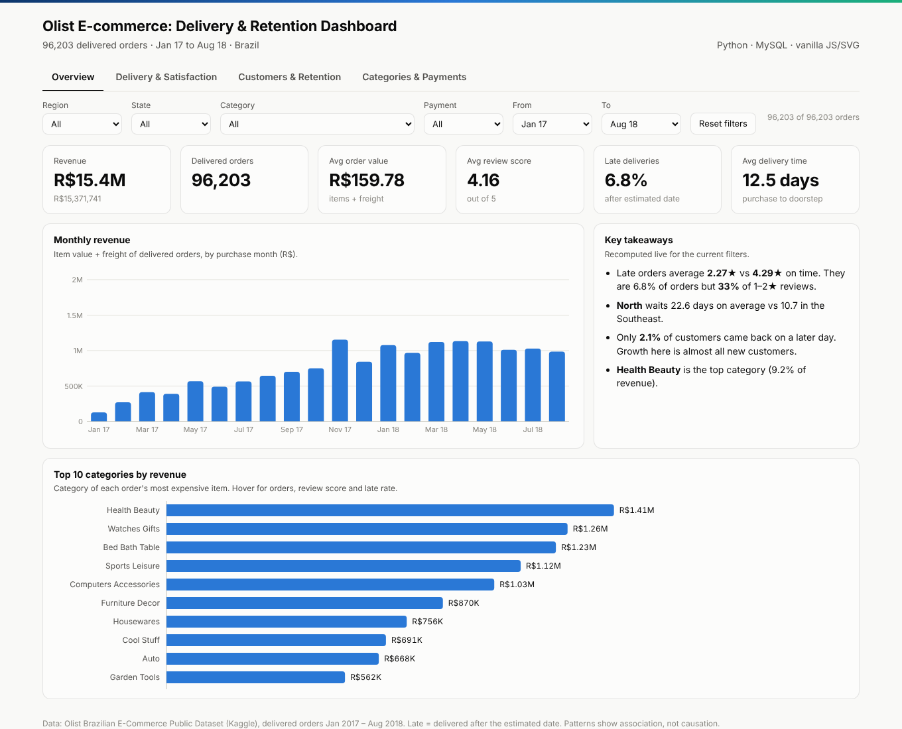
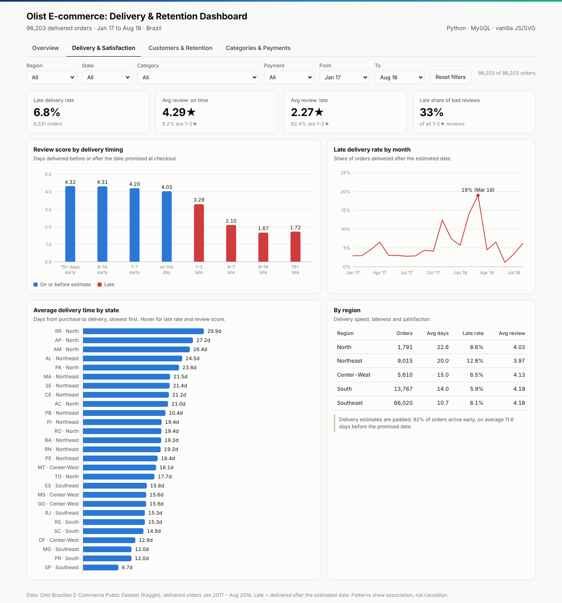
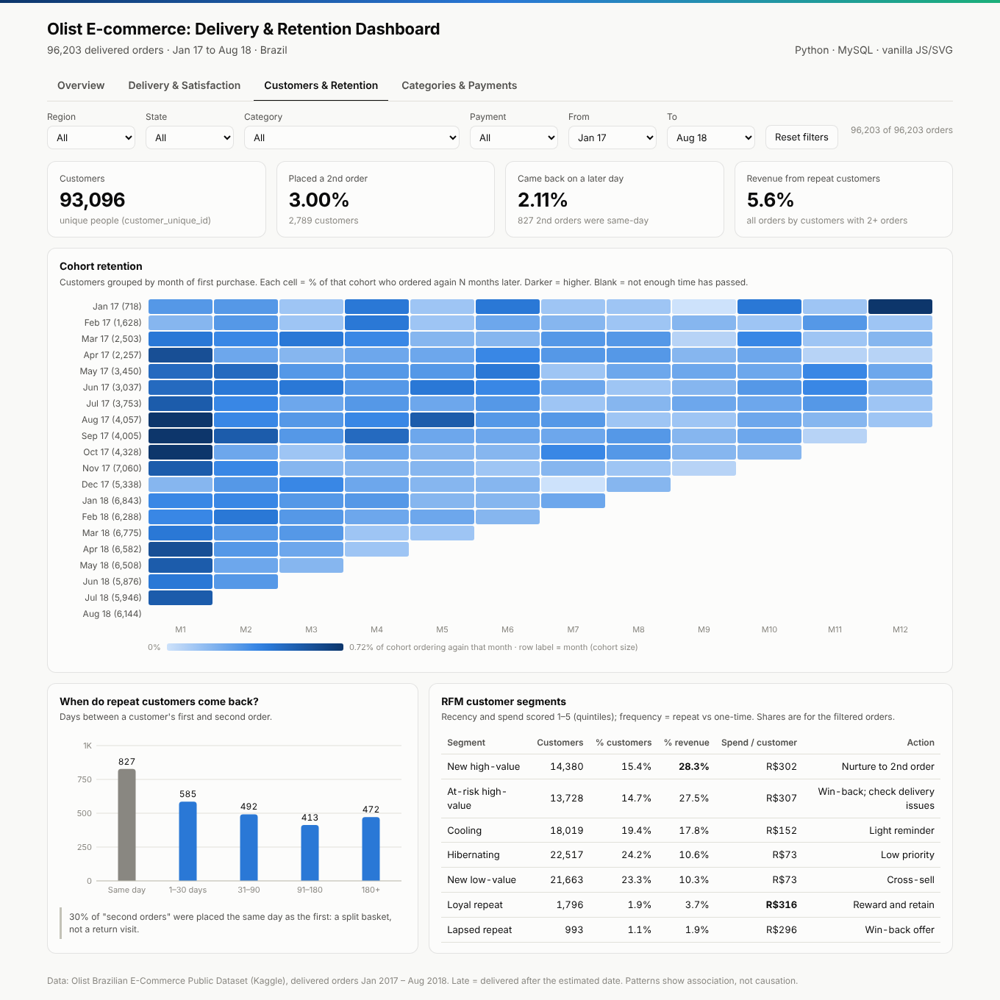
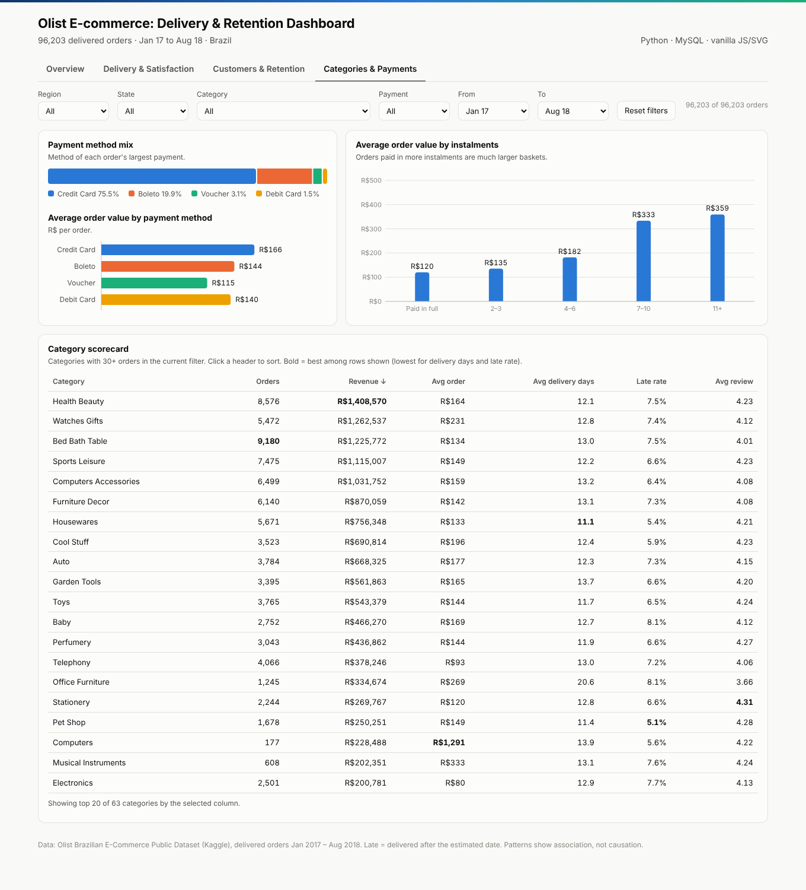

# Olist E-commerce: Customer Retention & Delivery Impact Analysis

An end-to-end analysis of **96,203 orders** from Olist, a Brazilian e-commerce marketplace. It answers two business questions: **how much do late deliveries hurt customer satisfaction**, and **do customers come back?**

Built with **MySQL** (multi-table joins, CTEs, window functions), **Python** (pandas, statistical testing, cohort and RFM analysis) and an **interactive web dashboard**.

**Live dashboard:** https://kashish1422.github.io/olist-ecommerce-analytics/Dashboard/ *(after GitHub Pages is enabled; see below)*

---

## Key findings

| | Finding |
|---|---|
| ⭐ | **Late orders average 2.27★ vs 4.29★ on time.** 62% of late orders get a 1–2★ review, against 9% of on-time orders (Mann-Whitney p < 0.001). |
| 📦 | Late orders are only **6.8% of orders but 33% of all 1–2★ reviews**. Delivering them on time would have removed about 28% of bad reviews. |
| 📈 | Lateness spikes with volume: **12% in Nov 2017 (Black Friday)** and **19% in Mar 2018**, against 3–7% in normal months. |
| 🗺️ | São Paulo averages **8.7 delivery days**; the North averages **22.6**. The Northeast has a **12.8% late rate** and the lowest review scores. |
| 🗓️ | Estimates are padded: **92% of orders arrive early**, typically about **12 days** before the promised date. |
| 🔁 | Only **3.0% of customers placed a second order**, and 30% of those were same-day split baskets. The **true return rate is 2.1%**. |
| 💰 | Two RFM segments (*New high-value*, *At-risk high-value*) are **30% of customers but 56% of revenue**. |
| 💳 | Orders split into 7–10 instalments average **R$333**, against **R$120** for orders paid in full. |

Full write-up: [Docs/Insights_Recommendations.md](Docs/Insights_Recommendations.md)

## Recommendations

1. Make the **on-time rate** the main satisfaction KPI, and add capacity before known peaks.
2. Fix the **Northeast and North delivery gap** with carrier SLAs or regional fulfilment.
3. **A/B test tighter delivery estimates** at checkout.
4. Launch a **second-purchase program** aimed at *New high-value* customers after an on-time delivery.
5. Use **interest-free instalments** as a basket-size lever on high-ticket categories, validated with an A/B test.

---

## Dashboard

A single self-contained HTML file with four pages and live filters for region, state, category, payment method and date range.

| Overview | Delivery & Satisfaction |
|---|---|
|  |  |
| **Customers & Retention** | **Categories & Payments** |
|  |  |

---

## Project structure

```text
olist-ecommerce-analytics/
├── Data/
│   ├── Raw/                      # 8 original Olist CSVs (geolocation excluded)
│   └── Processed/                # created by the notebook
│       ├── orders_clean.csv      # one row per delivered order
│       ├── customers_rfm.csv     # one row per customer with RFM segment
│       └── cohort_retention.csv
├── SQL/
│   ├── 01_schema.sql             # database, tables, keys
│   ├── 02_load_data.sql          # LOAD DATA + row-count validation
│   └── 03_analysis.sql           # clean view + 15 business queries
├── Python/
│   └── olist_analysis.ipynb      # cleaning, EDA, stats test, cohorts, RFM
├── Dashboard/
│   ├── index.html                # interactive dashboard (open in a browser)
│   ├── dashboard_template.html
│   ├── build_dashboard.py        # rebuilds index.html from Data/Processed
│   └── screenshots/
├── Docs/
│   ├── Business_Understanding.md
│   ├── Data_Dictionary.md
│   └── Insights_Recommendations.md
├── requirements.txt
└── README.md
```

## Skills demonstrated

- **SQL:** relational schema with primary and foreign keys, `LOAD DATA` with NULL handling, a reusable cleaned view, CTEs, and window functions (`ROW_NUMBER`, `LAG`, `RANK`, `NTILE`, `FIRST_VALUE`, running totals, `SUM() OVER ()` shares). Also covers cohort retention and RFM in pure SQL.
- **Data cleaning:** de-duplicating reviews, choosing the correct customer key, handling missing categories and translations, scoping out partial months, and validating that joins don't duplicate rows.
- **Analysis:** KPI design, cohort retention, RFM segmentation, delivery-delay bucketing, and a non-parametric hypothesis test (Mann-Whitney U).
- **Communication:** a dashboard with filters, documented business questions, and recommendations with stated limitations.

## Methodology highlights

- **Scope:** delivered orders purchased from Jan 2017 to Aug 2018. The sparse 2016 months and incomplete Sep–Oct 2018 are excluded.
- **Customer key:** `customer_unique_id`. Olist issues a new `customer_id` for every order, so using it would show zero repeat customers.
- **Revenue:** item price + freight from `order_items`. Payments can be split across several rows.
- **Late:** delivered after the estimated delivery date, compared by calendar day.
- **Reviews:** the latest review per order (551 orders have more than one).
- **Validation:** every SQL result in `03_analysis.sql` was checked against the pandas results. Headline counts match exactly.

## How to run

```bash
git clone https://github.com/kashish1422/olist-ecommerce-analytics.git
cd olist-ecommerce-analytics
pip install -r requirements.txt
```

1. **Python:** open `Python/olist_analysis.ipynb` and run all cells from the `Python/` folder. This writes `Data/Processed/`.
2. **SQL (MySQL 8.0+):** from the repo root, run `mysql --local-infile=1 -u root -p`, then `SOURCE SQL/01_schema.sql; SOURCE SQL/02_load_data.sql; SOURCE SQL/03_analysis.sql;`. If loading fails, run `SET GLOBAL local_infile = 1;` first.
3. **Dashboard:** open `Dashboard/index.html` in a browser. To rebuild it after re-running the notebook: `python Dashboard/build_dashboard.py`.

**Publish the dashboard:** in the repo, go to Settings → Pages → Deploy from a branch → `main` / root → Save.

## Limitations

- The data is observational, so it shows association, not causation. Lateness may also stand in for seller quality or remoteness.
- Satisfaction metrics cover delivered orders only. 643 delivered orders have no review.
- RFM frequency is effectively binary (repeat vs one-time) because 97% of customers ordered once.

## Data source & license

[Brazilian E-Commerce Public Dataset by Olist](https://www.kaggle.com/datasets/olistbr/brazilian-ecommerce), released by Olist under **CC BY-NC-SA 4.0**. The raw files are included unmodified for reproducibility. This project is non-commercial and shares its derived data under the same license.
